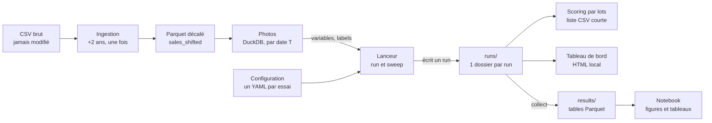

# Ingénierie : code, configurations, contrats

> **Rôle** : Comment le code est organisé, comment lancer une expérience, quels contrats respecter, dans quel ordre implémenter.
> **Pour** : Quiconque écrit ou lance du code.
> **À jour au** : 26/11/2026. Dates : les notebooks et `03_evidence.md` utilisent les dates d'origine du dataset (22/09/2022 au 22/09/2024) ; le code, les configs et les décisions utilisent les dates décalées de +2 ans (la photo de test du 22/03/2024 devient 22/03/2026).

## 1. Architecture du code : sobre et reproductible

- Un **paquet Python** (`src/churn/`) piloté par **un fichier YAML par expérience**. Les notebooks servent au récit et aux graphiques, pas au calcul. Ni Airflow, Prefect, DVC ni MLflow (ajoutable plus tard).
- **Principe central : on sauvegarde les prédictions, pas seulement les métriques.** Les métriques se recalculent dans un seul module : changer une définition tard ne demande aucun réentraînement.
- Un **run** = un dossier `runs/<run_id>/` avec la config résolue, le commit Git, l'empreinte des données, la graine, les prédictions, l'importance des variables et le modèle (les métriques sont calculées par `collect`). Toute option que l'on veut comparer **doit être dans la config**.
- Le **notebook de rapport ne lit que `results/`**.
- **Mise en production simulée** : un script de scoring par lots écrit un CSV (liste courte, score, valeur espérée, trois raisons en français). Pas d'API. L'architecture cible du cas réel tient sur une slide.
- Explicabilité : SHAP pour HGB et XGBoost, coefficients pour la régression logistique, aucune raison pour la baseline et BG/NBD ; trois raisons par client (`reasons_fr.yaml`). Importance globale : gain (XGBoost), permutation sur un échantillon d'entraînement (HGB).



## 2. Décisions d'ingénierie

| Sujet | Décision | Pourquoi |
| --- | --- | --- |
| Forme du code | Paquet `src/churn/` avec point d'entrée unique ; le notebook ne sert qu'au récit et aux graphiques | Les notebooks seuls ne sont ni reproductibles ni testables ; un framework complet serait de l'overkill |
| Orchestration | Lanceur en ligne de commande piloté par fichiers YAML : `run` (une expérience), `sweep` (une série), `collect` (fusion des runs en tables Parquet dans `results/`). Ni Airflow, Prefect, Dagster, DVC ni MLflow | Runs reproductibles et comparables ; MLflow reste ajoutable plus tard |
| Contenu d'un run | Configuration complète résolue, commit Git, empreinte des données, graine, prédictions par client et par date de photo, importance des variables ; modèle gardé en local | Toute option que l'on veut comparer doit être dans la configuration |
| Principe central | Sauvegarder les prédictions, pas seulement les métriques ; les métriques se recalculent dans un seul module | Changer une définition tard ne demande aucun réentraînement |
| Notebook de rapport | Lit uniquement `results/` et produit tous les graphiques et tableaux | Reprise simple à la fin, résultats réutilisables |
| Données | DuckDB + Parquet pour le calcul lourd ; pandas pour les tables de photos (\~120 000 clients par photo) | Déjà le choix du notebook d'exploration |
| Dates | Script d'ingestion unique : +2 ans sur `date_order` et `date_invoice`, écrit `sales_shifted.parquet` ; le CSV brut n'est jamais modifié ; plus aucun décalage ensuite | Éviter un double décalage ; pas de collision, car il n'y a aucune ligne le 29/02/2024 |
| Mise en production simulée | Script de scoring par lots qui écrit un CSV : liste courte, score, valeur espérée, trois raisons principales. Pas d'API | Rien n'est déployé dans l'exercice ; l'architecture cible tient sur une slide |
| Tableau de bord | Page HTML locale (`front/build.py` → `data/front/index.html`) qui rejoue les listes sur 24 dates hebdomadaires à partir du 22/09/2025, avec les modèles `final_backtest`, et affiche à part les résultats du test final lus dans `results/metrics.parquet` ; remplace la maquette Streamlit | Répond au risque d'adoption ; contient des données clients : ne pas diffuser |

## 3. Le dépôt et comment travailler dessus

### Mise en route

Prérequis : Python 3.12, ~8 Go de RAM.

```bash
python3.12 -m venv .venv
source .venv/bin/activate
pip install -r requirements.txt     # versions exactes, testées
pip install -e . --no-deps          # le paquet churn (les deux étapes : make setup)
python -m ipykernel install --user --name clientco-bcg
make test                           # au 26/11 : 198 passed, 2 skipped
```

**Les données ne sont pas dans Git** (~4 Go) : demandez le CSV à Aurélien ou récupérez-le via le dossier du cas, et placez-le dans `data/dataset_sales_2026.csv`. Le notebook `01_data_quality_and_activity_overview` le convertit en `data/sales.parquet` au premier lancement (~1 min).

### Carte du code

```
configs/base.yaml          toutes les options et leurs valeurs par défaut
configs/experiments/*.yaml une expérience = ce qui change par rapport à base.yaml
configs/sweeps/*.yaml      une série d'expériences (grille de surcharges)
src/churn/
  cli.py        commandes : ingest | run | sweep | collect | score
  config.py     configuration typée, chargement YAML, identifiant de run
  data.py       ingestion CSV → Parquet décalé, accès DuckDB
  snapshots.py  variables, labels, segments, découpage temporel
  models.py     baseline, BG/NBD, logreg, HGB, XGBoost, calibration, tuning
  scoring.py    V, VE, taille de liste (K), liste mixte, raisons, liste CSV
  evaluation.py métriques (depuis les prédictions)
  impact.py     impact en M€ et tornade
  comparison.py comparaison appariée par date, critère d'acceptation
  simulation.py définitions de V, listes mensuelles avec repos
  pipeline.py   run, sweep, collect
  reasons_fr.yaml  phrases affichées aux commerciaux
tests/          anti-fuite et tests unitaires
front/          tableau de bord HTML local
notebooks/      01 à 09 : exploration, périmètre, labels (preuves) ; experiment_report.ipynb (squelette non rempli)
docs/           documentation en français ; docs/subject/ = brief du cas (non versionné)
```

### Les commandes

```bash
python -m churn ingest                                    # une seule fois : data/sales_shifted.parquet
python -m churn sweep configs/sweeps/final_backtest.yaml  # plan glissant de la configuration finale
python -m churn collect                                   # runs/ → results/*.parquet
python -m churn collect --universe final                  # + métriques « tout le churn » des runs final*
python -m churn score <run_id> --date 2026-02-22          # liste d'action de 700 clients (CSV)
make test
```

**Garde-fou du test final.** Tout run ou liste daté du 22/03/2026 sur les vraies données est refusé sans `CHURN_FINAL_TEST=1`. `base.yaml` pointe sur cette date : `run configs/experiments/*.yaml`, `sweep configs/sweeps/models.yaml`, `make run` et `make sweep` (arguments par défaut) sont donc refusés sans la variable. En cas de refus ou d'erreur, la commande sort avec le code 2.

### Le contrat d'interface (à respecter, c'est ce qui permet de travailler en parallèle)

- **Table de photo** (`snapshots.py`) : `client_id, snapshot_date, <variables>, rhythm, label, horizon_days, gone, V, segment`. Variables « basic » : `recency_days, freq_180d, freq_90d, freq_prev_90d, rev_180d, rev_90d, rev_prev_90d, gap_median, gap_p90, recency_ratio, freq_trend, rev_trend` (les deux tendances sont des log-ratios : 0 = stable, < 0 = baisse).
- **Table de prédictions** (`evaluation.py`) : `run_id, client_id, snapshot_date, split, p_raw, p_cal, V, ev, label, gone, horizon_days, segment`.
- **Table de métriques** (`evaluation.evaluate_predictions`, une par run, fusionnée dans `results/metrics.parquet`) : `run_id, split, segment, metric, k, value, ci_low, ci_high`. Segment `all` : `capture_at_k`, `size_only_capture`, `oracle_capture` (une ligne par K de `evaluation.k_values`), `pr_auc`, `brier_raw`, `brier_cal` (`k` vide) ; un segment par valeur de `segment` : probabilités seulement. Définitions et choix dans `02_modeling_decisions.md` § 8 ; la liste des métriques demandées est `evaluation.metrics` (une métrique inconnue ou non implémentée est refusée). Avec `collect --universe` : `capture_total_at_k`, `size_only_total_capture`, `oracle_total_capture`.
- **Liste d'action** (`scoring.py`) : `rank, client_id, p_cal, V, ev, segment, reason_1, reason_2, reason_3` (score total seul).

Les docstrings de chaque fonction décrivent le comportement attendu. Le code de référence pour construire les tables client × jour est dans les notebooks `01` et `04`.

### Ordre d'implémentation (les dépendances)

Historique : les briques 1 à 6 sont écrites (liste mixte exceptée), le réseau de neurones n'a pas été fait.

1. `data.ingest`, `data.connect`, `data.build_client_day_table`, `data.fingerprint` : **tout le reste en dépend.**
2. `snapshots` : dates, variables, labels A et B, segments, découpage (labels connus avant le test).
3. `models` (baseline d'abord) et `pipeline.run`.
4. `evaluation` (CA capté @K en premier) et `pipeline.collect`.
5. `scoring` (V, VE, taille de liste, liste mixte, raisons) et `score_batch`.
6. Variantes : label B (relatif), second score (partiel), segments par valeur, Optuna, simulation d'impact et tornade.
7. Si du temps reste : petit réseau de neurones.


### Ordre des expériences

1. Baseline, logreg, HGB, XGBoost sur le label A (180 jours pour tous).
2. Label B (relatif) sur le meilleur modèle, second score (partiel) et variante par segment de valeur.
3. Optimisation du meilleur modèle.
4. Gel de la configuration et test final le 26/11 ([03](03_evidence.md), § 11).
5. Seulement s'il reste du temps : réseau de neurones.

## 4. Cadence : photos mensuelles ou hebdomadaires

Mesure du 18/11. Les photos hebdomadaires multiplient les lignes par 3,8 pour une qualité identique ; le gain en cadence ne se voit pas dans les résultats.

| Mesure | Mensuel | Hebdomadaire |
| --- | --- | --- |
| Photos d'entraînement | 7 | 27 |
| Lignes d'entraînement | 834 550 | 3 212 458 |
| Temps d'entraînement | 3 s | 12 s |
| AUC sur la photo de test | 0,860 | 0,860 |
| PR-AUC | 0,513 | 0,511 |
| F1 maximal (précision ; rappel) | 0,570 (0,47 ; 0,72) | 0,569 (0,46 ; 0,75) |
| CA churné capté, top 2 000 / 5 000 / 10 000 | 44,6 / 58,6 / 68,0 % | 45,1 / 58,7 / 68,3 % |

Conditions : 12 variables simples, HistGradientBoosting par défaut sans réglage, photo de test du 22/03/2024 (dates d'origine), classement par P × (CA des 180 derniers jours annualisé) sans décote ρ, label A (aucun achat dans les 180 jours). Le seuil du F1 est choisi sur le test, pour ce comparatif seulement. Mesure unique, à refaire avec les vraies variables.

Recommandation : photos mensuelles pour développer et régler (une optimisation de 50 essais en validation croisée à 5 plis, soit \~250 entraînements, prendrait \~12 min contre \~50 min), puis une vérification en hebdomadaire sur le modèle final.

## 5. Tests anti-fuite

Une suite de tests automatiques à lancer avant chaque série d'expériences (`tests/test_no_leakage.py`, `make test`) : variables de la photo T identiques sur données tronquées à T ; aucune fenêtre de label d'entraînement après la date de test ; AUC proche de 0,5 avec des labels mélangés ; variables de rythme calculées avec les seuls achats antérieurs à T ; calibration ajustée sans le test. Dans la suite complète, 2 tests sur données réelles sont skippés (un autre test laisse le cache redirigé) ; ils passent avec `pytest tests/test_simulation.py`.
