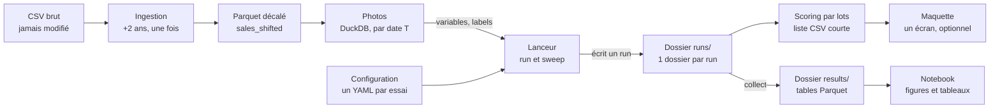

# ClientCo – Prévention du churn : enjeux, décisions et vigilances

18/11/2026 · équipe 3

> Version de référence : ce fichier. Le document en ligne n'est plus mis à jour depuis le 18/11/2026.

## Contexte et objectif

Ce document capitalise le travail de l'équipe 3 sur la prévention du churn de ClientCo : ce qui est en jeu, ce qui est décidé, ce qu'il faudra surveiller et ce qui pose problème. Il couvre la conversation du 17 au 18/11/2026.

**Le client (fictif).** Distributeur international de matériaux de construction : \~15,5 Md€ de CA en 2023, plus de 1 000 agences, plus de 15 pays, plus de 450 k clients actifs, \~200 commerciaux, marge brute ≈ 25 %. La CDO, arrivée il y a 3 mois, cherche un premier succès rapide et mesurable pour convaincre un ExCom réticent.

**Le use case.** La prévention du churn arrive en tête de la priorisation de l'équipe : seul use case dont les données (transactions) sont disponibles dès le premier jour, et le plus cité dans les interviews (5 sur 8). Il sera le deep dive : modèle, feuille de route 2027, puis un second use case avec ses besoins en données.

**Cadre de l'exercice.** Les données sont inventées : on les traite comme si elles couvraient 2025 et 2026 (décalage de +2 ans appliqué une fois pour toutes). Il faut donc penser une solution globale, tout en se limitant à ce que l'on peut démontrer avec les transactions seules.

| Échéance | Contenu |
| --- | --- |
| Nov 20, 2026 | Tutorat BCG et Case Team Meeting : liste des use cases, priorisation, issue tree, structure algorithmique |
| Nov 26, 2026 à 12h | Rendu des modèles algorithmiques |
| Nov 26, 2026 à 17h | Rendu des slides (5 à 10 planches, annexes possibles) |
| Nov 27, 2026 | Présentation finale au CEO : 45 min + 15 min de débrief |

Ce que le jury attend : de la structure, des hypothèses fondées sur le business, un modèle qui répond au problème, des plans actionnables, une histoire claire, des méthodes que l'on sait défendre, et des chiffres étiquetés (Confirmé, Source unique, Déduit, Manquant).

## Enjeux

Le vrai enjeu n'est pas de prédire qui part, mais de déclencher une action commerciale qui change le résultat, et de le prouver. Prédire n'est pas prévenir.

### Enjeux business

- **Prouver la valeur vite.** Budget serré, ExCom réticent, CEO sans cap clair. La Commercial Director cite la mesure du succès comme son « deep pain point ».
- **Le goulot est la capacité commerciale.** \~200 commerciaux, une visite coûte 3 h + 1 h de suivi, le téléphone est jugé « le meilleur » canal. Le seul indicateur utile est la qualité des K clients que l'on peut réellement traiter.
- **L'objectif est le chiffre d'affaires.** On classe donc par euros espérés protégés, pas par probabilité seule.
- **L'adoption est le premier risque de déploiement.** OffSupp : la plupart des équipes n'ont pas adopté les nouveaux processus immédiatement. Le Sales Manager doute que la data « résume » une relation client, et le CRM est peu rempli.
- **Le chiffrage actuel est fragile.** Le +1 % de revenus de la CDO est une source unique, d'une autre entreprise.

### Enjeux techniques

- **Churn non contractuel.** Aucune résiliation : le client cesse d'acheter. La définition de la perte est un choix, pas une donnée.
- **Base très hétérogène.** Occasionnels, PME régulières, clients sous contrat, institutions publiques, grands comptes : un seul modèle et un seul seuil ne tiennent pas.
- **Peu de données.** Transactions seulement, sur un sous-ensemble d'agences et de clients, deux ans d'historique.
- **Corrélation, pas causalité.** Un client à risque n'est pas forcément un client « persuadable ». Sans groupe témoin, aucun CA « sauvé » n'est vérifiable.

### Ce que disent les interviews

| Interlocuteur | Position sur le churn |
| --- | --- |
| CDO | Le juge le plus faisable : données de ventes accessibles, peu d'effectifs. Avance +1 % de revenus (expérience passée, source unique). |
| Head of Sales | « Hot topic depuis des années », jamais de solution efficace ; veut embarquer ses équipes. |
| Commercial Director | Impact financier potentiellement majeur, mais doute que la data soit la priorité. |
| Sales Manager | Sceptique (« impédictible »), prêt à essayer ; préfère un outil de cross-sell. |
| OffSupp (benchmark) | Quick win facile à piloter ; le défi est le déploiement auprès des équipes locales. |
| Supply Chain | Ruptures et délais seraient les premières causes de départ (non testable sans données de stock). |

## Constats clés des données

Le churn est mesuré à 3,4–4,8 % du CA par an, bien en dessous de l'hypothèse centrale de 8 % du chiffrage d'équipe, et il est prévisible chez les clients réguliers. Source : notebook d'exploration `churn_exploration_viz.ipynb` (photo du 22/03/2024 dans les dates d'origine, base = clients actifs sur 180 jours, churn = aucun achat dans les 180 jours suivants).

| Thème | Constat | Conséquence |
| --- | --- | --- |
| Volumétrie | 63,3 M de lignes, 170,6 k clients, 582 « agences », 2 ans de commandes | Sous-ensemble de l'entreprise (>450 k clients, >1 000 agences) |
| Concentration | 1 % des clients = 31 % du CA ; les 13 % de clients à 104+ jours d'achat = 76 % du CA ; les 26 % à 1–3 jours = moins de 1 % | Raisonner par segment et en valeur |
| Rythme d'achat | Écart médian 3 j, p95 = 36 j, p99 = 126 j ; l'écart typique varie d'un facteur \~20 selon le client | Aucun seuil universel de churn |
| Taux de churn | 18 % des clients actifs par semestre, mais \~3 % du CA. Plus petit décile de CA : 52,5 % de churn ; plus gros : 2,2 % (mais \~35 % du CA churné) | Évaluer le modèle en CA |
| CA perdu par an | 3,4 % (12 mois contre 12 mois) à 4,8 % (semestre annualisé) | Hypothèse centrale de 8 % à corriger |
| Érosion | Les reculs supérieurs à 20 % (–469 M) sont presque compensés par les hausses (+448 M) ; un recul supérieur à 50 % est durable pour \~62 % des clients concernés | Second label « chute durable de CA » |
| Signaux | Chez les réguliers, l'AUC de la récence atteint 0,90 ; les futurs partants décrochent \~5 mois avant ; une chute de fréquence de plus de 50 % sur 90 j = \~15 % de churn contre 1–2 % ailleurs | Le churn est prévisible, au moins chez les réguliers |
| Récence relative | AUC 0,88 chez les réguliers, 0,55 sur toute la base | Variables de rythme seulement avec assez d'historique (6 achats ou plus) |
| Canaux | Téléphone = 64 % du CA ; en ligne = 9 % ; visite commerciale = 0,05 % des lignes | Le téléphone est le canal naturel ; l'effet d'une visite est invisible |
| Clients multi-agences | 47 % achètent dans plusieurs agences | L'agence est un mauvais identifiant client |
| Effet agence | \~1 % d'agences atypiques après correction de la mixité de fréquence | Utile pour choisir des agences pilotes |
| Nouveaux clients | \~1/3 rachètent le mois suivant, 86–91 % refont un achat sous 6 mois | Phase d'intégration à part |

### Impact recalculé

Chiffrage de l'équipe : CA × part perdue × détection (50 %) × rétention (20 %) × marge brute (24,65 %). Avec la part perdue mesurée, l'impact passe de 30,6 M€ à **13–18 M€ de marge par an**. La détection de 50 % est cohérente avec la baseline simple (53 % du CA churné capté par une liste de 10 000 clients). La rétention de 20 % n'est pas mesurée ; chaque point de rétention vaut \~0,8 M€ de marge par an (calcul dérivé, à confirmer dans le fichier de chiffrage).

### Corrections apportées en cours de conversation

| Affirmation initiale | Correction après lecture du notebook |
| --- | --- |
| « 4 à 7,5 % du CA inactif » (clients inactifs 60 à 180 jours) | C'était un stock cumulé. En flux annuel : 3,4 à 4,8 % |
| « 8 % de CA perdu : à vérifier » | Mesuré sous cette valeur ; le scénario bas (5 %) est le plus réaliste |
| « La récence relative est une bonne variable » | Vrai chez les réguliers seulement |
| Dates d'origine du dataset | Fichier nommé 2026 mais commandes de 2022 à 2024 : dates fictives, décalage de +2 ans retenu |

## Décisions prises

L'architecture retenue est volontairement sobre : un petit paquet Python piloté par des configurations, des runs comparables, et un notebook de rapport qui ne lit que les résultats.

### Décisions actées

| Sujet | Décision | Pourquoi |
| --- | --- | --- |
| Forme du code | Paquet `src/churn/` avec point d'entrée unique ; le notebook ne sert qu'au récit et aux graphiques | Les notebooks seuls ne sont ni reproductibles ni testables ; un framework complet serait de l'overkill |
| Orchestration | Lanceur en ligne de commande piloté par fichiers YAML : `run` (une expérience), `sweep` (une série), `collect` (fusion des runs en tables Parquet dans `results/`). Ni Airflow, Prefect, Dagster, DVC ni MLflow | Runs reproductibles et comparables ; MLflow reste ajoutable plus tard |
| Contenu d'un run | Configuration complète résolue, commit Git, empreinte des données, graine, prédictions par client et par date de photo, métriques, importance des variables ; modèle gardé en local | Toute option que l'on veut comparer doit être dans la configuration |
| Principe central | Sauvegarder les prédictions, pas seulement les métriques ; les métriques se recalculent dans un seul module | Changer une définition tard ne demande aucun réentraînement |
| Notebook de rapport | Lit uniquement `results/` et produit tous les graphiques et tableaux | Reprise simple à la fin, résultats réutilisables |
| Données | DuckDB + Parquet pour le calcul lourd ; pandas pour les tables de photos (\~120 000 clients par photo) | Déjà le choix du notebook d'exploration ; `duckdb` est à ajouter à `requirements.txt` |
| Dates | Script d'ingestion unique : +2 ans sur `date_order` et `date_invoice`, écrit `sales_shifted.parquet` ; le CSV brut n'est jamais modifié ; plus aucun décalage ensuite | Éviter un double décalage ; pas de collision, car il n'y a aucune ligne le 29/02/2024 |
| Découpage temporel | Strict, avec embargo : les fenêtres de label d'entraînement finissent avant la date de la photo de test ; pas de réentraînement sur la validation avant le test | Évite la fuite temporelle |
| Cadence | Scoring hebdomadaire en cible (routines hebdomadaires de la Commercial Director) ; entraînement sur photos mensuelles | Limite la redondance entre lignes quasi identiques |
| Modèles | Baseline (récence ÷ écart p90), régression logistique, HistGradientBoosting et XGBoost, probabilités calibrées | Couvre les prérequis du brief, reste explicable |
| Réseau de neurones | Pas par défaut ; au plus un petit perceptron limité à une demi-journée si du temps reste, documenté « testé, non retenu » | Sur du tabulaire de cette taille, les arbres boostés égalent ou battent presque toujours un réseau |
| Hyperparamètres | Optuna (30 à 50 essais) une fois le meilleur modèle choisi, validation temporelle, test intact ; chaque essai est un run | Le détail du découpage de validation reste à fixer |
| Segmentation | Un seul modèle avec le segment de fréquence comme variable, évalué par segment ; l'option `per_segment` est à tester ensuite si le résultat déçoit | Des modèles séparés réduisent trop les échantillons |
| Mise en production simulée | Script de scoring par lots qui écrit un CSV : liste courte, score, valeur espérée, trois raisons principales. Pas d'API | Rien n'est déployé dans l'exercice ; l'architecture cible tient sur une slide |
| Tableau de bord | Maquette d'un seul écran de la liste hebdomadaire du commercial (Streamlit, lecture du CSV de scoring), limitée à une journée ; go ou no-go le 24/11 selon que le modèle est figé et qu'une personne est libre ; capture plutôt que démo en direct | Répond au risque d'adoption ; les résultats d'analyse restent dans les slides |

### Architecture



Le notebook de rapport ne lit que `results/` ; le scoring par lots et la maquette partent du meilleur run.

### Cible et horizon

Le temps pour partir dépend du client. On sépare donc la **définition de la perte** (relative au rythme du client) de l'**horizon de décision** (une contrainte d'action en jours calendaires). Trois étapes, chacune une option de configuration :

1. **Horizon par classe de rythme** (valeurs de départ à calibrer) : rapide (écart médian de 7 jours ou moins) H = 30 j ; moyen (8 à 30 jours) H = 60 j ; lent (plus de 30 jours) H = 120 j ; moins de 6 achats H = 180 j, avec la baseline seule.
2. **Label relatif au client** : H\_i = k × écart p90 du client, borné entre 30 et 180 jours, avec k parmi 1,5, 2 et 3.
3. **Modèle de survie en temps discret**, seulement s'il reste du temps.

Le rythme est calculé strictement avant la date de la photo, et seulement à partir de 6 achats. Un second label, la chute durable de CA de plus de 50 %, est prévu comme variante.

### Orientation sur le score

Le score principal sera la valeur espérée, ce qui répond à l'objectif d'augmenter le CA. Sous l'hypothèse d'un taux de rétention identique pour tous, classer par valeur espérée maximise le CA protégé sous contrainte d'appels.

```latex
VE(client) = P(\text{départ}) \times V(client)
```

V est le CA que le client aurait généré s'il était resté. La sortie est un classement de K clients : identifiant, probabilité calibrée, V, VE, rang, segment, trois raisons principales, canal suggéré. Les arbitrages sur V, la capacité et le seuil sont détaillés plus bas.

Ordre de grandeur d'après les déciles du notebook (taux de churn × CA moyen sur 12 mois) :

| Décile de CA | Taux de churn | CA moyen | Valeur espérée moyenne |
| --- | --- | --- | --- |
| 10 (gros) | 2,2 % | 283 k | \~6 200 |
| 9 | 4,0 % | 57 k | \~2 300 |
| 8 | 5,6 % | 27 k | \~1 500 |
| 1 (petits) | 52,5 % | 234 | \~120 |

### Valeur à risque, capacité et seuil

Validé le 18/11 : un seuil minimal de probabilité calibrée et une liste séparée pour les grands comptes (sinon un modèle propre aux déciles de CA les plus élevés), V par défaut sur les 180 derniers jours annualisés, et K traité comme un paramètre. Les deux ajustements demandés par l'équipe (décote ρ et paliers de capacité), décrits ci-dessous, sont validés eux aussi.

- **V n'est pas une prévision du CA réel.** Prédire le CA futur d'un client à partir de son passé donnerait \~0 pour ceux qui partent, et compterait le départ deux fois (dans P et dans V). V est donc le CA que le client aurait généré **s'il restait**, estimé sur son rythme récent. Si l'on teste un modèle de prévision, il est entraîné uniquement sur les clients qui restent.
- **Décote ρ.** Un client à risque a déjà décliné : même sauvé, il achètera probablement moins qu'avant (les futurs partants décrochent \~5 mois avant ; un recul de plus de 50 % est durable pour \~62 % des clients concernés). On applique un coefficient ρ à V, calibré sur les clients qui ont chuté sans partir. La valeur espérée devient P × ρ × V ; ρ est étiqueté « Déduit ».
- **Capacité par paliers.** Une partie des commerciaux est dédiée à la prévention du churn (pas tous, car ils poursuivent le reste de leur activité) et traite le haut du classement ; le reste de la liste est traité par appels. K est alors la somme des paliers. Paramètres : part de commerciaux dédiés, actions par semaine par palier, coût d'opportunité des commerciaux dédiés. Résultat présenté en courbe du CA capté selon K, par palier.

### Évaluation, validation et simulation

Validé le 18/11 (tour 4), sauf le rythme des photos d'entraînement (mesure plus bas, recommandation à confirmer) :

- **Mesure principale.** CA churné capté dans les K premiers : somme de V des vrais partants du top-K, divisée par la somme de V de tous les vrais partants, par palier de capacité. C'est la mesure comparable quand H varie selon le client.
- **Métriques sur les probabilités (ajout de l'équipe).** Précision, rappel et F1 à un seuil, courbe précision-rappel, PR-AUC, ROC-AUC et score de Brier pour la calibration. Les seuils sont choisis sur la validation (F1 maximal, seuil minimal métier, top-K), jamais sur le test. Elles servent à régler et comparer les modèles ; la décision business reste le CA capté. Toujours par segment, avec des intervalles de confiance par bootstrap sur les clients, et en version pondérée par V.
- **Découpage.** Test sur la photo du 22/03/2026, jamais touchée. Entraînement sur les photos du 22/03/2025 au 22/09/2025 (embargo de 180 jours avant le test). Comparaisons internes et optimisation par validation croisée en 5 plis groupés par client, car un embargo interne de 180 jours est impossible sur 6 mois de photos.
- **Tests anti-fuite.** Une suite de tests automatiques avant chaque série d'expériences : variables de la photo T identiques sur données tronquées à T ; aucune fenêtre de label d'entraînement après la date de test ; AUC proche de 0,5 avec des labels mélangés ; variables de rythme calculées avec les seuls achats antérieurs à T ; ρ et calibration ajustés sans le test.
- **Simulation d'impact.** Trois scénarios (bas, central, haut) sur la rétention (10, 20, 30 %), avec la part de CA perdue mesurée et la détection issue du backtest ; graphique en tornade sur quatre paramètres (part perdue, détection, rétention, ρ) ; impact net du coût d'opportunité ; Monte Carlo seulement en annexe.
- **Architecture cible du cas réel.** Une slide en cinq blocs : ingestion hebdomadaire, scoring hebdomadaire, liste dans l'outil du commercial avec saisie de l'action et du motif, journalisation avec groupe témoin, suivi mensuel (calibration, dérive, adoption).
- **Ordre des expériences, sans dates ni échéances internes.** 1) baseline, régression logistique, HistGradientBoosting et XGBoost sur le label de l'étape 1 ; 2) label relatif (étape 2) et variante par segment de valeur ; 3) optimisation du meilleur modèle ; 4) gel du code ; 5) seulement s'il reste du temps, la variante « chute durable de CA » et le réseau de neurones. Le modèle de survie n'est pas planifié. Seules les échéances du brief (20/11, 26/11, 27/11) restent fixes.

**Photos mensuelles ou hebdomadaires : mesure du 18/11.** Les photos hebdomadaires multiplient les lignes par 3,8 pour une qualité identique ; le gain en cadence ne se voit pas dans les résultats.

| Mesure | Mensuel | Hebdomadaire |
| --- | --- | --- |
| Photos d'entraînement | 7 | 27 |
| Lignes d'entraînement | 834 550 | 3 212 458 |
| Temps d'entraînement | 3 s | 12 s |
| AUC sur la photo de test | 0,860 | 0,860 |
| PR-AUC | 0,513 | 0,511 |
| F1 maximal (précision ; rappel) | 0,570 (0,47 ; 0,72) | 0,569 (0,46 ; 0,75) |
| CA churné capté, top 2 000 / 5 000 / 10 000 | 44,6 / 58,6 / 68,0 % | 45,1 / 58,7 / 68,3 % |

Conditions : 12 variables simples, HistGradientBoosting par défaut sans réglage, photo de test du 22/03/2024 (dates d'origine), classement par P × (CA des 180 derniers jours annualisé) sans décote ρ, label de l'étape 1 (aucun achat dans les 180 jours). Le seuil du F1 est choisi sur le test, pour ce comparatif seulement. Mesure unique, à refaire avec les vraies variables.

Recommandation : photos mensuelles pour développer et régler (une optimisation de 50 essais en validation croisée à 5 plis, soit \~250 entraînements, prendrait \~12 min contre \~50 min), puis une vérification en hebdomadaire sur le modèle final.

**Lecture d'un graphique en tornade (exemple illustratif).** Chaque ligne fait varier un seul paramètre entre sa valeur basse et haute, les autres restant au cas central ; les lignes sont triées de la plus grande amplitude à la plus petite. Impact central : 15,7 M€ de marge par an (CA 15,5 Md€, marge 24,65 %, part perdue 4,1 %, détection 50 %, rétention 20 %). La plage de ρ est fictive, ρ n'étant pas mesuré.

| Paramètre | Valeur basse → haute | Impact (M€ de marge par an) | Amplitude (M€) |
| --- | --- | --- | --- |
| Rétention | 10 % → 30 % | 7,8 → 23,5 | 15,7 |
| ρ (fictif) | 0,6 → 1,0 | 9,4 → 15,7 | 6,3 |
| Détection | 40 % → 60 % | 12,5 → 18,8 | 6,3 |
| Part de CA perdue | 3,4 % → 4,8 % | 13,0 → 18,4 | 5,4 |

La rétention domine : c'est l'hypothèse à mesurer en priorité, par le pilote.

## Deux plans : exercice et cas réel

Dans l'exercice rien n'est déployé : on prouve hors ligne ce qu'on peut avec les transactions, et on décrit le reste sur le papier. Dans le cas réel, un pilote randomisé apporte la preuve causale.

|  | Plan A : exercice | Plan B : cas réel |
| --- | --- | --- |
| Données | Transactions seulement | Transactions, journal d'actions, CRM, contrats, stocks |
| Preuve de valeur | Backtest hors ligne et simulation avec hypothèses | Pilote randomisé avec groupe témoin |
| Uplift | Non réalisable, présenté comme étape future | Après lecture du pilote, si justifié |
| Livrable | Code (26/11, 12h), 5 à 10 slides (26/11, 17h), oral (27/11) | Programme sur 12 mois |
| Discours | Voici ce que nous avons mesuré et ce que nous supposons | Voici ce que le pilote a prouvé |

### Plan A : dans les contraintes de l'exercice

- **Calendrier.** 17 au 19/11 : figer la définition du churn, préparer le schéma de l'algorithme. 20/11 : tutorat et Case Team Meeting. 21 au 23/11 : baseline, variables, modèles, backtest. 24 et 25/11 : évaluation en CA, simulation d'impact, explicabilité, gel du code. 26/11 : rendus. 27/11 : présentation.
- **Impact.** CA × part de CA perdue (mesurée) × détection (mesurée au backtest) × rétention (hypothèse en scénarios, par exemple 10, 20 et 30 %) × marge de 24,65 %. Une simulation sur ces scénarios donne une fourchette plutôt qu'un chiffre unique.
- **Ce qu'on dit.** Le churn est prévisible chez les clients réguliers, la valeur est dans le haut de la base, la rétention est une hypothèse à valider.
- **Ce qu'on ne fait pas.** Pas de modèle d'uplift avec des traitements inventés : le jury le verrait. On annonce aussi les limites (sous-ensemble de clients, pas de journal d'actions, contrats inconnus).

Storyline de 10 slides au maximum : 1) synthèse et demande ; 2) programme global, les 5 use cases en feuille de route 2027, le churn en premier ; 3) l'enjeu mesuré ; 4) définition du churn et segmentation ; 5) modèle et performance face à la baseline, en CA ; 6) impact en M€, scénarios et sensibilité ; 7) mise en œuvre : playbook, pilote, indicateurs d'adoption ; 8) feuille de route 2027 et second use case ; 9) budget, ressources, risques ; 10) prochaines étapes. En annexe : qualité des données, contrôles anti-fuite, détails du modèle.

### Plan B : dans le cas réel

| Phase | Durée indicative | Contenu | Critère de passage |
| --- | --- | --- | --- |
| 0. Cadrage et données | 4 à 6 semaines | Définir le churn avec les métiers ; marquer contrats, institutions publiques, grands comptes ; récupérer CRM, journaux d'appels, stocks, délais | Définition validée par le Head of Sales et la Commercial Director |
| 1. Modèle et backtest | 6 à 8 semaines | Baseline, modèle par segment, validation temporelle, évaluation en CA | Le modèle bat la baseline en CA sous contrainte de capacité |
| 2. Pilote randomisé | 3 à 6 mois | Randomisation par client stratifiée, tous niveaux de risque, journalisation de chaque action, \~25 % de témoins | Échantillon suffisant, suivi complet |
| 3. Lecture et décision | 4 à 6 semaines | Effet moyen, puis par décile de risque et par segment ; taux de rétention réel | ROI positif confirmé |
| 4. Uplift (optionnel) | 2 à 3 mois | T-learner, X-learner ou forêt causale, courbe de Qini sur données randomisées mises de côté | L'uplift bat le classement par risque × valeur |
| 5. Industrialisation | En continu | Scoring hebdomadaire, liste courte par commercial, suivi de dérive, groupe témoin permanent de faible taille | Adoption mesurée (listes consultées, appels passés, motifs saisis) |

Les durées sont des propositions de ma part, pas des données du client. Le plan A correspond aux phases 0 et 1 du plan B ; les phases 2 à 5 deviennent la feuille de route 2027 présentée.

### Articulation churn, pilote et uplift

Un client « persuadable » est un client dont l'action change le comportement : cet effet individuel n'est jamais observable, il ne peut venir que d'une expérience. Cibler les clients « moyennement récents » est une approximation de l'uplift fondée sur le risque (hypothèse d'un effet maximal au milieu) ; l'uplift mesure cet effet au lieu de le supposer.

La dépendance est asymétrique : le scoring de churn est un prérequis du pilote (il définit la population et la stratification), et l'expérience est un prérequis de la preuve (le scoring seul ne prouve pas que l'action sauve du CA).

- **Randomisation.** Dans la liste à risque, on tire au sort qui est appelé (traiter) et qui ne l'est pas (témoin) ; la comparaison des deux groupes donne l'effet de l'appel.
- **Journalisation.** On note qui a réellement été appelé, quand, par qui, par quel canal, avec quel résultat. Elle ne se rattrape pas après coup : un traitement non enregistré est perdu, et un groupe témoin reconstruit est biaisé.
- **Stratification.** On tire au sort à l'intérieur de groupes homogènes (segment de fréquence, tranche de valeur, niveau de risque), pour que les deux groupes aient la même composition.
- **Taille.** Ordre de grandeur à confirmer : avec 44 % de churn dans la liste et une rétention de 20 % (\~9 points), l'effet moyen se détecte avec \~500 clients par groupe ; apprendre des effets différents par segment demande de l'ordre de 4 fois plus par sous-groupe.
- **Recouvrement.** Le pilote doit inclure tous les niveaux de risque, sinon on ne peut pas tester l'hypothèse de la fenêtre d'intervention.
- **Uplift.** Première analyse simple : l'effet moyen par décile de risque et par segment. Les modèles (T-learner, X-learner, forêt causale) ne servent que si l'effet varie au-delà du risque et si l'échantillon le permet.

Proposé pour la feuille de route 2027 (à valider) : trimestre 1, modèle de churn et mise en place de la randomisation ; trimestre 2, pilote et lecture ; trimestre 3, uplift si justifié ; trimestre 4, déploiement élargi.

## Vigilances pour plus tard

Les risques les plus coûteux sont la fuite temporelle, un signal qui arrive trop tard pour agir, et une rétention supposée plutôt que mesurée. Classés par criticité :

| Vigilance | Pourquoi | Parade prévue |
| --- | --- | --- |
| Fuite temporelle (embargo) | Avec 2 ans, une photo exige un historique avant elle et 180 jours de suivi après. Les 7 photos poolées du notebook se chevauchent : les utiliser pour entraîner puis tester ferait « voir le futur » au modèle. Une AUC supérieure à 0,95 est presque toujours une fuite | Historique des variables limité à 180 jours ; entraînement sur les photos dont le suivi finit avant la date de test ; test automatique de non-chevauchement |
| Signal trop tardif | L'AUC de 0,90 de la récence est en partie mécanique : un client silencieux depuis 170 jours est déjà presque perdu | Juger le modèle sur sa capacité à alerter tôt (tendances de fréquence et de CA), pas sur le silence |
| Calibration | Multiplier une probabilité par V suppose que 0,05 signifie 5 % ; un boosting brut ne le garantit pas | Calibration isotonique ou de Platt sur la validation, par segment et par classe de rythme |
| Précision en baisse | Dans une liste de gros clients, le taux de base est \~2 % : la part de vrais partants sera faible même avec un bon modèle (44 % pour la liste « récence relative ») | Assumer l'échange précision contre euros ; seuil minimal de probabilité |
| Définition de V | Le CA passé surestime ce que perdent les clients en déclin avant de partir | Tester le CA des 180 derniers jours annualisé, le CA 12 mois, une prévision |
| Peu de partants chez les gros clients | \~240 événements par semestre dans le décile 10 : modèle instable, résultat dominé par quelques comptes | Intervalles de confiance par bootstrap ; variante par segment de valeur |
| Grands comptes déjà suivis | Les grands comptes et clients à interlocuteur dédié feront remonter dans le classement des comptes où l'appel apporte peu | Liste séparée pour leur responsable si le client les marque |
| Horizons incomparables | Avec un H par client, les taux de churn ne se comparent plus d'un segment à l'autre | Mesure commune en CA : CA réellement perdu capté dans les K premiers clients |
| Maturité du label | Un horizon long exclut les photos les plus récentes ; les clients lents ont le plus de censure | Horizons courts pour les clients rapides ; calibrer les classes de rythme sur les données |
| Saisonnalité | 2 ans seulement : un seul recoupement annuel ; trois creux d'activité (mai 2023, sept. 2023, mai 2024) tombent dans les fenêtres | Ne pas utiliser de jour de semaine ; indicateur du mois ; à signaler dans le deck |
| Rétention non mesurée | Les 20 % de rétention du chiffrage sont une hypothèse sans mesure | Scénarios 10, 20, 30 % dans l'exercice ; pilote avec témoins dans le cas réel |
| Sous-ensemble du réseau | Un client « perdu » a peut-être acheté hors périmètre du dataset : churn surestimé ; l'extrapolation à 15,5 Md€ suppose un échantillon représentatif | À annoncer comme limite ; question au tutorat |
| Segments non identifiables | Contrats long terme, institutions publiques, appels d'offres : leur inactivité n'a pas le même sens | Question au tutorat ; sinon modèle par segment de valeur |
| Adoption | OffSupp : la plupart des équipes n'ont pas adopté immédiatement ; Sales Manager sceptique | Raisons lisibles par client, Head of Sales embarqué, indicateurs d'adoption définis avant le déploiement |
| Confidentialité | Le brief est classé confidentiel ; `docs/` n'est pas dans `.gitignore` alors que le dépôt a un remote GitHub dont la visibilité n'est pas connue | Ignorer `docs/`, `runs/`, prédictions et modèles ; ne jamais versionner de données ; ne pas coller les comptes rendus dans des outils non approuvés |

Rappel des règles du brief : ne livrer que ce que l'on sait expliquer et défendre, vérifier chaque chiffre, et étiqueter les preuves (Confirmé, Source unique, Déduit, Manquant).

Vigilances ajoutées le 18/11 :

- **Double comptage du churn.** Si V est prévu sur le CA réel, la probabilité de départ est appliquée deux fois.
- **Coût d'opportunité.** Dédier des commerciaux à la prévention retire du temps à leurs autres ventes ; le CA sauvé doit le dépasser.
- **Relation client.** Un commercial dédié ne connaît pas forcément le client, alors que beaucoup ont un interlocuteur attitré ; l'effet d'un appel peut être plus faible que celui du commercial habituel.

## Problèmes et anomalies identifiés

Les données ont plusieurs anomalies qui affectent le modèle ; les documents du dossier se contredisent en plusieurs endroits. Chaque point est à traiter ou à signaler dans le deck.

### Dans les données

| Anomalie | Détail | Traitement retenu |
| --- | --- | --- |
| Dates de commande | Du 22/09/2022 au 22/09/2024 alors que le fichier s'appelle 2026 | Dates fictives : +2 ans, appliqué une fois par le script d'ingestion |
| `date_invoice` | De 2021 à 2026 ; 29 % des lignes facturées après la commande, 4,1 % à plus de 30 jours ; 99 lignes avant la commande | Utiliser `date_order` comme date d'activité |
| Lignes négatives | 3,8 % des lignes ; retours = 577 M, 5,8 % du CA positif | Un avoir n'est pas un achat ; il compte comme signal, pas comme activité |
| Lignes à zéro | 3,8 % des lignes | Jour d'achat = ventes strictement positives |
| Jour de semaine | Dimanche \~14 % du CA, samedi \~0 % : dates décalées | Aucune variable de jour de semaine |
| Calendrier | Aucune ligne le 29/02/2024 | Pas de collision au décalage ; à signaler |
| Creux d'activité | Trois creux qui divisent l'activité par \~2 : mai 2023, sept. 2023 (inexpliqué), mai 2024 | Un silence pendant un creux n'est pas forcément une perte ; question au tutorat |
| Quantité | Jamais inférieure à 3, même sur les lignes négatives | La quantité ne signale pas les retours ; le signe de `sales_net` oui |
| « Agences » | \~100 des 582 servent moins de 50 clients, presque tout par téléphone | Probablement des centres d'appels ou comptes clés ; question au tutorat |
| Démarrage | \~80 k clients « nouveaux » en sept.–oct. 2022 | Ce sont des clients existants vus pour la première fois (censure à gauche) ; période de chauffe de 3 mois |
| Canaux | Téléphone = 64 % du CA et en ligne = 9 %, contre « 60 % en agence » et « online quasi nul » dans les documents | À clarifier ; signaler l'écart |

### Dans les documents

- **Devise.** Le fichier Financials est en EUR alors que le deck Key Facts parle de 15,5 Md$. Le dataset n'indique pas de devise.
- **Pertes de 50 M** (Supply Chain) : ni la devise ni la nature (CA ou marge) ne sont précisées.
- **+1 %** (CDO) : « income growth » est ambigu (CA ou résultat) et vient d'un plus petit acteur APAC. **+2 %** (OffSupp) : autre secteur, non transposable tel quel. **+1 %** du cross-sell : source la plus faible, un article lu par le Sales Manager.
- **Fonctions** : la Data Engineer est aussi citée Data Scientist ; le Supply Chain Director est cité Supply Chain Manager dans le brief ; les anciennetés de l'équipe data diffèrent entre la slide 20 et le compte rendu.
- **Absences.** Aucun taux de churn dans les interviews ; aucune interview du Marketing, de la Finance ni du CEO.

### Dans l'environnement de travail

- Le CSV de 4,2 Go ne se charge pas dans pandas : DuckDB et Parquet sont indispensables.
- Le `requirements.txt` actuel ne liste ni `duckdb` ni de bibliothèque de modélisation (scikit-learn, XGBoost, Optuna, SHAP).
- Le notebook `exploratory_and_data_update.ipynb` prévoyait un décalage de +5 ans qui n'a pas été appliqué dans le fichier ; remplacé par la décision de +2 ans.
- La synthèse du notebook (section 10) est incohérente avec son propre tableau de la section 9 : elle annonce 57 % du CA churné capté par la récence relative contre 28 % pour la récence brute, et 29 % des partants pour la récence brute, alors que le tableau donne, pour 10 000 clients, 53 % et 23 % du CA. Ces chiffres semblent venir d'une exécution antérieure : à réconcilier avant de les montrer.

## Questions ouvertes

Trois décisions attendent une réponse de l'équipe, et neuf questions sont à poser au tutorat du 20/11. Le seuil de probabilité, les grands comptes, V par défaut, K paramétré, la décote ρ et les paliers de capacité sont déjà validés. Les recommandations ci-dessous restent des propositions tant qu'elles ne sont pas confirmées.

### Décisions en attente

| Décision | Recommandation proposée |
| --- | --- |
| Explicabilité | SHAP (TreeExplainer) pour les modèles boostés, coefficients pour la régression logistique, importance par permutation sur le test ; trois raisons par client en langage commercial |
| Git et partage des runs | Ignorer `docs/`, `runs/`, prédictions et modèles ; versionner code, configurations et `results/runs.parquet` ; une configuration exécutée ne se modifie jamais ; branches courtes et petites pull requests vers `main` |
| Répartition des rôles | A données (chemin critique, 3 premiers jours), B modèles, C évaluation, impact et explicabilité, D récit, second use case et maquette ; contrat d'interface = schéma de la table de photos (`client_id`, date T, variables, labels), écrit dès le 18–19/11 et présenté comme structure algorithmique au CTM |

### Tour de questions à venir

- Métrique commune d'évaluation et taille du top-K : CA réellement perdu capté dans les K premiers clients, rapporté au CA total perdu.
- Découpage de validation, compatible avec l'embargo et l'horizon retenu.
- Tests anti-fuite et de cohérence des labels.
- Simulation d'impact : scénarios de rétention, par exemple trois scénarios ou une simulation de Monte Carlo.
- Architecture cible du cas réel (scoring hebdomadaire, suivi de dérive, journalisation du pilote).

### Questions au tutorat du 20/11

| # | Question | Pourquoi elle compte |
| --- | --- | --- |
| 1 | Comment le dataset a-t-il été échantillonné (agences et clients) ? Un client peut-il acheter hors périmètre ? | Le churn est peut-être surestimé |
| 2 | Peut-on marquer les clients sous contrat, institutions publiques et grands comptes centralisés ? | Leur inactivité n'a pas le même sens ; ciblage des gros clients |
| 3 | Combien d'appels par semaine un commercial peut-il passer ? | Fixe la taille K de la liste ; aucun chiffre dans les documents |
| 4 | Existe-t-il un journal d'appels ou un CRM exploitable, et des rotations ou absences de commerciaux ? | Première estimation d'effet par inférence causale sur données d'observation, ou quasi-expériences |
| 5 | Quelle devise (Key Facts en dollars, Financials en euros) ? Que signifie une ligne négative, et pourquoi la quantité vaut au moins 3 ? | Interprétation des montants et des retours |
| 6 | Que sont les \~100 « agences » de moins de 50 clients, presque tout au téléphone ? | Centres d'appels ou comptes clés ? |
| 7 | Qu'explique le creux de mi-septembre 2023 ? Pourquoi aucune ligne le 29/02/2024 ? | Fenêtres d'étiquetage et jours manquants |
| 8 | Que représente `date_invoice` et pourquoi déborde-t-elle jusqu'en 2026 ? Les visites commerciales sont-elles saisies (0,05 % des lignes) ? | Choix de la date d'activité ; effet d'une visite invisible |
| 9 | Les 50 M de pertes : CA ou marge, quelle devise ? Le +1 % de la CDO : CA ou résultat ? Les onglets A à N de Financials sont-ils des concurrents ? | Fiabilité du chiffrage |

## Prochaines étapes

Le contrat d'interface (schéma de la table de photos) et le script d'ingestion débloquent tout le reste : sans eux, modèles et évaluation ne peuvent pas avancer en parallèle.

- [ ] Répondre aux trois décisions en attente (section Questions ouvertes)
- [ ] Écrire le contrat d'interface (schéma de la table de photos) avant le Nov 19, 2026
- [ ] Ajouter à `.gitignore` : `docs/`, `runs/`, prédictions et modèles ; compléter `requirements.txt` (DuckDB, scikit-learn, XGBoost, Optuna, SHAP)
- [ ] Écrire le script d'ingestion (+2 ans sur les deux dates) et produire `sales_shifted.parquet`
- [ ] Réconcilier la synthèse du notebook (section 10) avec son tableau de la section 9
- [ ] Mettre à jour la feuille de chiffrage du fichier de priorisation avec la part de CA perdue mesurée (3,4 à 4,8 %)
- [ ] Préparer pour le CTM du Nov 20, 2026 la structure algorithmique et les questions au tutorat
- [ ] Décider du tableau de bord (go ou no-go) le Nov 24, 2026
- [ ] Geler le code le Nov 25, 2026 pour le rendu du Nov 26, 2026 à 12h

Prochain tour de questions de cadrage : métrique commune, découpage de validation, tests anti-fuite, simulation d'impact et architecture cible du cas réel.
